<p align="center">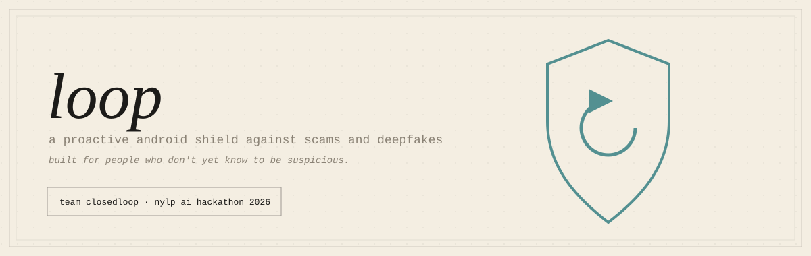</p>

**Loop — a proactive Android shield that checks the link before it opens and the call before you trust it. Built by Team ClosedLoop for the NYLP AI Hackathon 2026.**

Loop is a **proactive** shield, not a reactive scanner. It's built for people who don't yet know to be suspicious — not for people who already do.

<p align="center">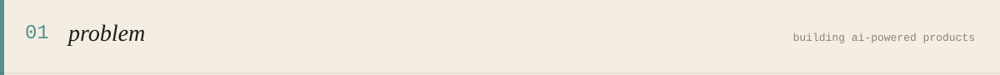</p>

The NYLP AI Hackathon's theme is *Building AI-Powered Products*. The same technology also powers the scams. Generative AI makes cloned voices, fake images and convincing phishing messages cheap to produce, and the people hit hardest are the ones who don't yet know to be suspicious: low-literacy, Urdu-first users in Pakistan, often on a shared Android phone. This is a digital literacy problem as much as a technical one. Existing tools are text-heavy, English-first and reactive: they only help someone who already suspects something is wrong, and they answer in language many users can't read.

<p align="center">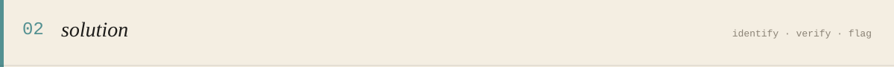</p>

<p align="center">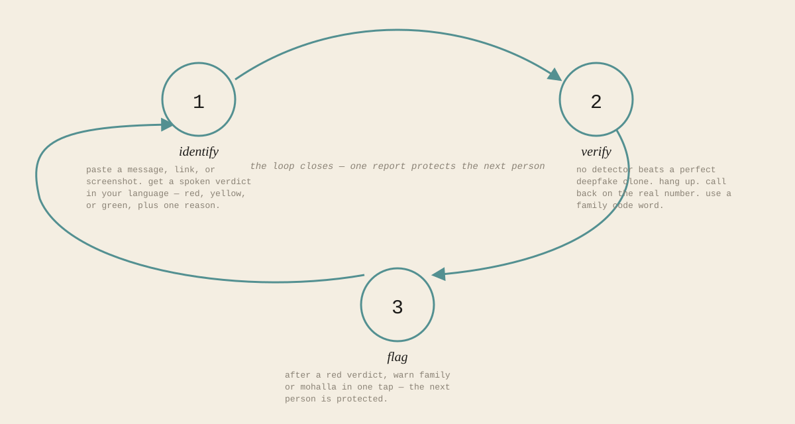</p>

- **Identify:** paste or share a message, link, photo or video. Loop answers with a colour (green / yellow / red), one plain sentence, and what to do next, shown in English or Urdu and read aloud.
- **Verify:** for voice and video "emergencies" there's no reliable detector, so Loop doesn't pretend to have one. It forces the one defence that beats even a perfect clone: hang up, call back on the saved number, ask the family code word.
- **Flag:** one tap reports a scam link or phone number, and **Warn my family** shares a ready-made warning in Urdu and English.

Android is the core of the design, not an afterthought. Loop registers as a handler for `http`/`https` links, so a tapped link gets checked before it opens. Android's share sheet gives a share-to-Loop flow with no onboarding needed, and a floating bubble keeps Loop one tap away.

Full product reasoning, trust principles, and stated limitations: [`docs/pitch/loop-brief.md`](docs/pitch/loop-brief.md) (original concept) and [`docs/pitch/PITCH_BRIEF.md`](docs/pitch/PITCH_BRIEF.md) (as built).

<p align="center"></p>

<p align="center">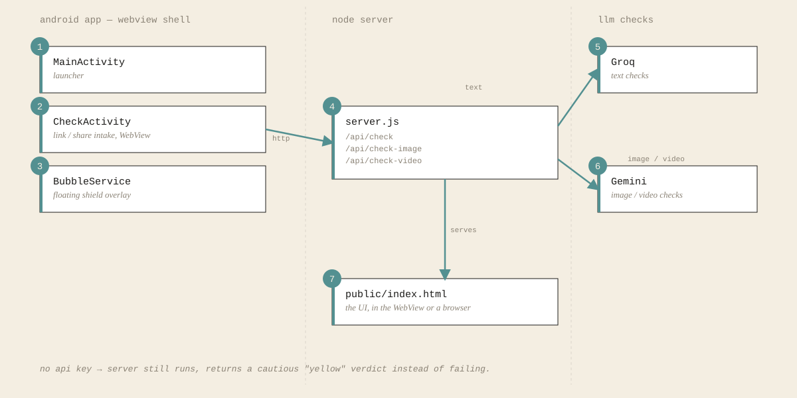</p>

- `server.js` — plain Node `http` server, no framework. Routes `/api/check`, `/api/check-image`, `/api/check-video`, `/api/report` and `/health`, rate-limits `/api/*`, and serves `public/`.
- `verdict.js`, `image-verdict.js`, `video-verdict.js` — build the LLM prompt/response per input type. Each fails safe to a cautious yellow verdict if the API call fails or a key is missing.
- `link-check.js` — AI-free link checks run before the LLM: OpenPhish and URLhaus known-bad lists (refreshed hourly), optional Google Safe Browsing, shortener expansion, and lookalike-brand / punycode detection. Known-bad links return red instantly.
- `gemini.js` — shared Gemini call with fallback to a lighter model on overload/quota errors, plus a verdict cache.
- `community.js`, `db.js`, `client-ip.js` — community scam reports. Users report a link or Pakistani mobile number with one tap; once 3 different devices from at least 2 different networks report the same item within 90 days, everyone who checks it gets a red "N Loop users reported this" verdict. Reports are capped at 20 per device per day. Stored in Turso (hosted SQLite) over its HTTP API; only the extracted item and hashes of an anonymous device ID and the reporter's network are kept, never message text. Known-safe sites can't be reported.
- `load-env.js` — hand-rolled `.env` loader, no dependency.
- `public/index.html` — the UI. Loads inside the app's WebView, also works directly in a browser.
- `android/` — the Android shell: link handler, share target, floating bubble, all pointing at the Node server. Links to a short list of known-safe sites (major banks, Google, YouTube, etc.) open directly without ever reaching the server.

<p align="center">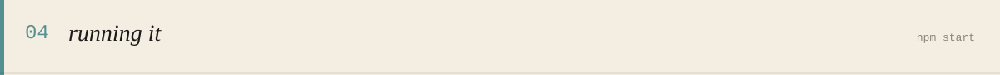</p>

```bash
npm start        # http://localhost:3000
npm test         # test_check.js + test_community.js
```

Requires a `.env` in the project root (not committed):

```
GROQ_API_KEY=...
GEMINI_API_KEY=...
SAFE_BROWSING_API_KEY=...   # optional
TURSO_DATABASE_URL=https://<db>-<user>.turso.io   # community reports; optional
TURSO_AUTH_TOKEN=...
```

No keys, no crash — the server still runs and returns a generic cautious verdict instead of failing.

To run the Android shell: open `android/` in Android Studio and run it on a device, then enter the server address on the app's home screen (your Render URL, or `http://<laptop-LAN-IP>:3000` for a local server on the same Wi-Fi).

**Deploying (Render, free tier):** the repo includes a `render.yaml` blueprint. In the Render dashboard choose *New → Blueprint*, pick this repo, and paste `GROQ_API_KEY` / `GEMINI_API_KEY` when prompted. Free instances sleep after ~15 minutes idle, so the first request after a quiet spell takes up to a minute while it wakes.

<p align="center">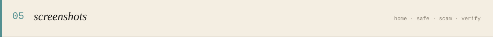</p>

| Home | Safe (green) | Scam (red) |
|---|---|---|
| 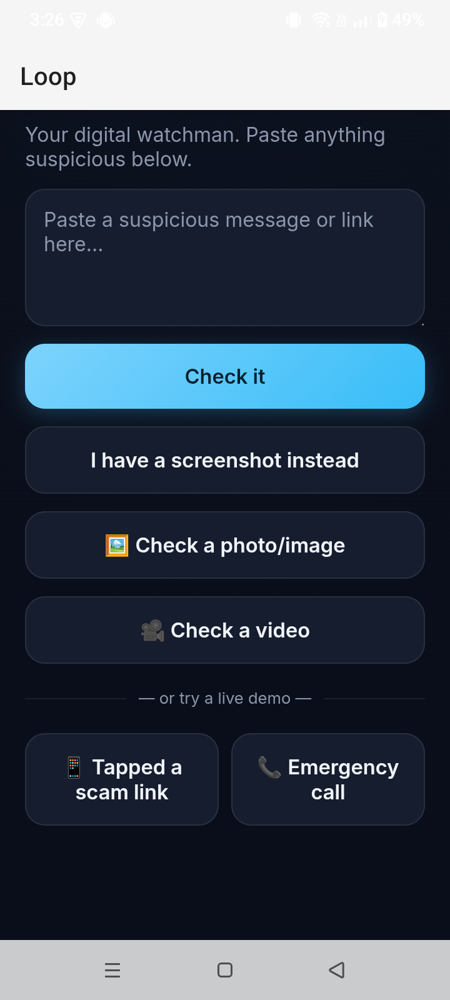 | 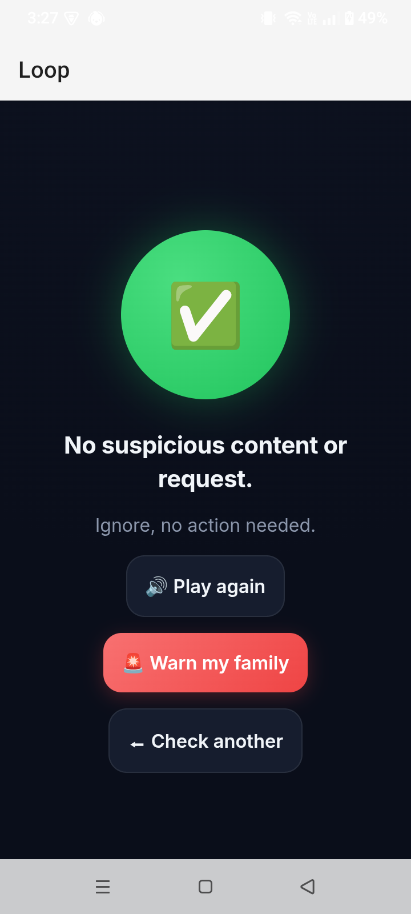 | 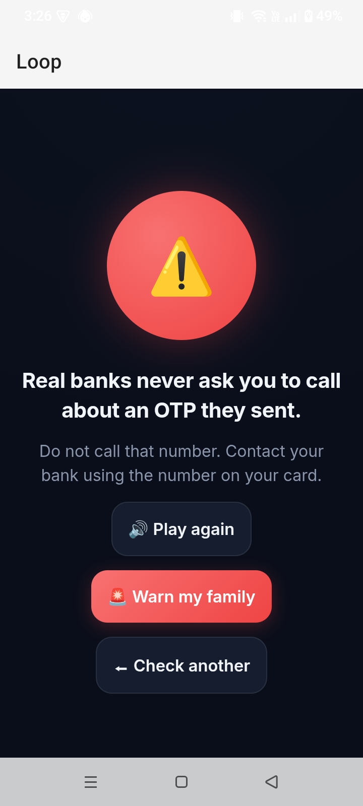 |
| Paste a message/link, or try a live demo | No suspicious content — nothing to do | Fake-OTP-helpline scam caught, with one plain reason |

| Proactive link interception | Verify (voice/video emergency) |
|---|---|
| 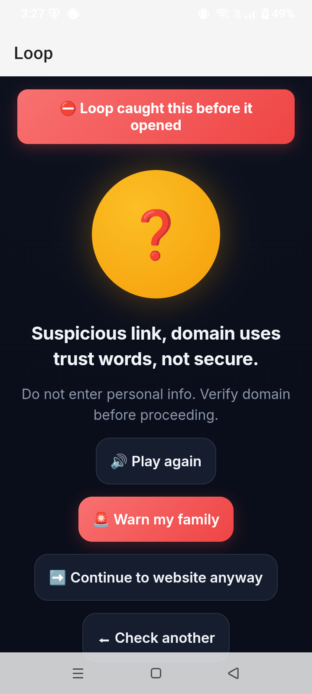 | 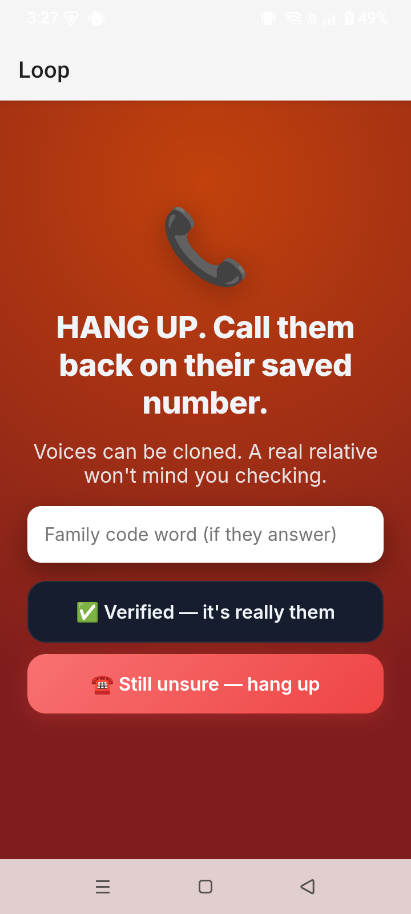 |
| A tapped scam link is caught *before* it opens | Forces the one defence that beats even a perfect clone: hang up, call back, family code word |

## Built during NYLP (Oct 16–18, 2026)

**Community scam flagging** — the FLAG step, previously a placeholder pop-up, made real ([changelog](docs/CHANGELOG.md), [design](docs/superpowers/specs/2026-10-16-community-flags-design.md)):
- One-tap **Report this scam** on red/yellow verdicts and **Warn my family** share message in Urdu and English, with the scam link defanged (`[.]`) — `public/index.html`, `android/app/src/main/java/com/loop/app/CheckActivity.kt` (share bridge).
- `POST /api/report`, item extraction (domains, user-content pages, Pakistani mobile numbers, redirect unwrapping), 3-devices / 2-networks / 90-days threshold, 20-per-day cap — `community.js`, `server.js`.
- Turso storage over plain `fetch` — `db.js`. Spoof-resistant client IP via Cloudflare's `cf-connecting-ip` — `client-ip.js`.
- Tests — `test_community.js`.

**Cloud deployment and AI-free link checks** ([changelog](docs/CHANGELOG.md)):
- Render deployment with `/health` and per-IP rate limiting — `render.yaml`, `server.js`.
- OpenPhish / URLhaus / Safe Browsing lists, shortener expansion, fake-brand and punycode warnings — `link-check.js`.
- Gemini model fallback and verdict cache — `gemini.js`.
- On-device known-safe list, loading/error screens and Android 15 edge-to-edge fixes — `android/app/src/main/java/com/loop/app/CheckActivity.kt`, `MainActivity.kt`.

Loop builds on an earlier prototype by Arham, Baneen Raza, Ayesha Mariyum and Samra Saeed (Social Nova Hackathon 2026); the features listed above were built by Team ClosedLoop during the NYLP build window.

### Roadmap (not yet built)

- **Urdu voice-first verdicts.** Today verdicts can be shown in Urdu and read aloud with the phone's text-to-speech (`ur-PK`, in `public/index.html`), but that predates NYLP and is still screen-first: the user taps a toggle and reads. A voice-first flow (spoken input, Urdu audio as the primary output, no reading required) is not implemented.

<p align="center">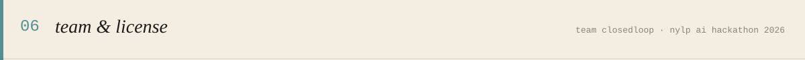</p>

**Team ClosedLoop** — [NYLP AI Hackathon 2026](https://www.nylp.com.pk/careers), part of the Global Summit on Digital Literacy & Leadership, organised by the National Youth Leadership Programme (NYLP).

- Muhammad Arham — Team Lead
- Baneen Raza <!-- TODO: role -->
- Muhammad Ali <!-- TODO: role -->
- Rabia Basree <!-- TODO: role -->
- Asra Ahmed <!-- TODO: role -->

[MIT](LICENSE)
